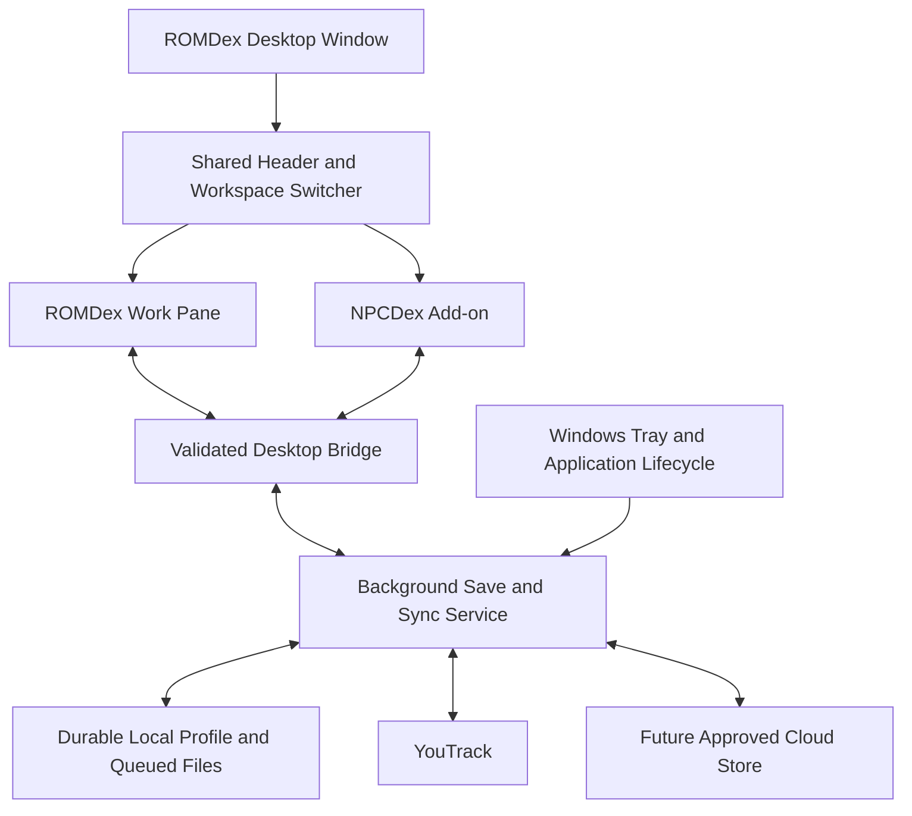

# U02 — ROMDex Desktop Host and Distribution Design

**U13A superseding decision (October 15):** The user requires saves inside the application folder and retained on uninstall. The installer is therefore per-user Forge/WiX MSI with a retained Data directory; Electron and the background service remain approved. The original U02 proposal below is historical. See [storage revision](U13A-Storage-and-Installer-Revision.md).

**Date:** October 14, 2026.  
**Authorization:** PASSKEY for U02 design/research only.  
**Status:** Approved by the user during U02. No runtime, installer, application setting or working data has been changed. Implementation remains subject to later task-specific PASSKEYs.

## Recommendation

Build **ROMDex** as a Windows desktop application using **Electron**, packaged with **Electron Forge and Squirrel.Windows**. Retain the existing HTML/CSS/JavaScript interfaces and tested YouTrack adapter. Run synchronization and durable saves in a background Node service owned by the application.

ROMDex is the primary application/workflow. **NPCDex is a built-in add-on**, reached through the shared workspace switcher. The active-tool header still shows ROMDex or NPCDex as previously agreed; the Windows application, Start Menu shortcut and installer are called ROMDex. Additional downloadable add-ons or a plugin marketplace are outside this phase.

The main tradeoff is a larger download and memory footprint because Electron includes its own web engine/runtime. For this project, reusing the tested JavaScript/Node implementation is the stronger priority. This is a project judgment, not a measured performance comparison. Electron documents its bundled components and separation between native application control and HTML/CSS/JS renderers. [Process model](https://www.electronjs.org/docs/latest/tutorial/process-model), [maintenance responsibilities](https://www.electronjs.org/docs/latest/tutorial/security).

## Decisions Confirmed During U02

| Decision | Confirmed Behavior |
| --- | --- |
| Application identity | **ROMDex**; NPCDex is an add-on to its workflow. |
| Application updates | **Notify Me and Ask Before Updating**. Check for new releases, then wait for Update Now before downloading/installing. Data synchronization is separate. |
| Private testing | **Unsigned installers**; reconsider signing before wider distribution. No signing purchase/account setup is authorized. |
| Existing lifecycle | Close to Windows tray; explicit Quit exits. |
| Existing save controls | Shared Save Changes and Auto-Sync for both workspaces; manual Save runs once while Off and leaves it Off. |
| Existing cloud constraint | Free hosting only; provider selection and provisioning remain later approval gates. |

## Desktop Host Comparison

These ratings concern the inspected applications, not framework quality in general. No installer-size or memory benchmark was run.

| Option | Fit With Current Work | Distribution/Runtime Implication | Assessment |
| --- | --- | --- | --- |
| **Electron + Node utility service** | Existing browser interfaces and Node modules can be retained, with transport/storage/lifecycle adapters. | Bundle the web engine and Node runtime in the installer; the user needs neither a separate Node installation nor Chrome for routine use. | **Recommended:** least change to the tested application logic; larger runtime package. |
| **Tauri 2 + Node sidecar** | Interfaces remain usable, but ROMDex still needs its Node service or a backend rewrite. | Adds a Rust host/build chain, architecture-specific sidecar packaging and WebView2 provisioning. | Credible size-focused alternative; more integration work for this existing backend. |
| **Native Windows host + WebView2** | Interfaces can be embedded, with a new native bridge and separately managed Node backend. | Adds a C#/native host and WebView2 distribution choices; another language/runtime boundary to maintain. | Viable Windows-only alternative; no clear benefit sufficient to justify the added host work here. |

Tauri documents external sidecars and its Windows/WebView2 installer choices. Microsoft documents Evergreen and fixed WebView2 deployment. A runtime missing on a target device must be handled even when most machines already have it. The extra-work rankings above are inferences from those requirements and ROMDex's existing Node service. [Tauri sidecars](https://v2.tauri.app/develop/sidecar/), [Tauri Windows distribution](https://v2.tauri.app/distribute/windows-installer/), [Microsoft WebView2 distribution](https://learn.microsoft.com/en-us/microsoft-edge/webview2/concepts/distribution).

## Evidence From the Current Applications

| Inspected Source | Finding | Design Consequence |
| --- | --- | --- |
| `outputs/ROMDex/public/store.mjs` | Workspace persistence and request transports can be injected. Polling, scheduling, online events and visibility events currently run in the renderer. | Reuse the transaction/reconciliation logic, separating browser lifecycle from a headless coordinator. |
| `outputs/ROMDex/public/attachment-files.mjs` | Queued file bytes currently have a separate browser IndexedDB store. | Transfer bytes and metadata deliberately; importing workspace JSON alone is insufficient. |
| `outputs/ROMDex/server.mjs` | Node backend, loopback HTTP transport, serialized work/journal, native adapter, attachment proxy and Windows DPAPI helper. | Keep domain logic; add a desktop transport/bootstrap rather than launching the browser server unchanged. |
| `outputs/ROMDex/runtime-profile.mjs` | Established AppData profile and installation/build identity; credentials are outside the release. | Keep explicit profile locations and verified migration independent of product version. |
| `Downloads/npcdex-v2.42/npcdex.html` | IndexedDB snapshots, browser directory handle and `npcdex-agent-export.json` file saving; generated HTML contains inline code. | Use native controlled import/export and app-owned durable saves; browser folder permissions and inline-script packaging need adaptation. |
| R08 release/checkpoint | ROMDex 0.4.0, 299 original issue IDs retained; NPCDex saved revision 72 at capture. | Use these as evidence/recovery material. Refresh actual working data at U12/U15; do not treat this snapshot as permanently current. |

The observed development runtime is x64. Propose x64 for the first Windows build. Confirm the selected Electron version's OS/runtime support at U10 and test the user's Windows installation; ARM64 and additional platforms are separate builds. Do not pin a future implementation to an untested version today.

## Application Structure

Propose one native window with a shared header and separately scoped tool views. Keep visited views alive when switching so selection, scroll, filters, pane sizes and editor text remain available. `WebContentsView` is the preferred Electron container for those tool surfaces; the exact shared-header geometry remains U05. Earlier browser-stage work can use isolated documents behind the same tool interface. [Electron WebContentsView](https://www.electronjs.org/docs/latest/api/web-contents-view).

The main process owns the tray, native dialogs, application lifecycle, validated bridge, credential operations and update handoff. A supervised **Node utility process** owns durable application state and synchronization. Its service interface supports independent provider status/timeouts so a YouTrack outage does not block healthy cloud work. After an unexpected process exit, recover recorded work before resuming sends; ambiguous native results enter reconciliation rather than blind retry. [Electron utility processes](https://www.electronjs.org/docs/latest/api/utility-process).

This is a target architecture. U04 defines the actual ownership/transaction contracts; U09 extracts a coordinator and storage interfaces; U10 hosts them in Electron. Existing browser tests remain useful through the injected transports. There must be one owner of each local queue, not simultaneous foreground and background implementations sending the same work.

## Reliable Background Behavior

| User/System Action | Proposed Result |
| --- | --- |
| Switch to NPCDex | ROMDex continues enabled sync; NPCDex keeps its own view context. |
| Close or Alt+F4 | Persist current edits/drafts, hide the window, retain tray/service. No command window is required. |
| Reopen shortcut / tray | Restore the existing instance and active workspace. Do not start another service. |
| Auto-Sync Off | Pause automatic data transfers for both tools; keep edits and queued files durable. |
| Save Changes while Off | Run one save/sync cycle for both providers and remain Off. |
| Explicit Quit | Flush local edits/queues, record uncertain in-flight work, stop the service and exit. Offline remote work remains queued; Quit does not require a successful network save. |
| Sleep, shutdown or crash | Rely on already-durable writes. Resume/restart checks current native state before replaying uncertain operations. |

The tray menu should expose Show ROMDex, Open NPCDex, Save Changes, the shared Auto-Sync setting, connection/update status, and Quit. Exact menu labels/layout belong to U05/U11. Starting with Windows is not enabled automatically; add a reviewed opt-in later if desired.

The design does not depend on keeping a hidden page's timers running. Electron background throttling is enabled by default; disabling it is not a persistence/recovery strategy. Windows shutdown may also bypass ordinary Electron quit events, so saving only at exit is insufficient. [Web preferences](https://www.electronjs.org/docs/latest/api/structures/web-preferences), [application lifecycle](https://www.electronjs.org/docs/latest/api/app), [resume events](https://www.electronjs.org/docs/latest/api/power-monitor).

An application-wide single-instance lock plus a profile/service ownership lock prevents duplicate local writers. A renderer crash can reload that tool from durable state while the service continues. A utility-process restart is bounded and visible; repeated failures pause affected operations for review. These are implementation requirements for U10/U11, not behavior verified by this design task.

## Files, Storage and Credentials

Propose a stable private root **`%LOCALAPPDATA%/ROMDexDesktopData`**, separate from the installer's program directory and from the existing `%LOCALAPPDATA%/ROMDex` legacy profile. The internal installer identity can remain `ROMDexDesktop`, with user-facing product name **ROMDex**. Freeze package/shortcut identity before first installation; cosmetic title changes must not silently create a new data folder.

| Area | Contents / Rule |
| --- | --- |
| Program installation | Versioned bundled code/assets/runtime only. No current saves or tokens. |
| Durable workspace | NPCDex content/assets/history/receipts; ROMDex queue/journal/metadata/files; preferences and schema/migration marker. U04 selects the exact storage format. |
| Chromium session area | Stable tool origins/partitions and UI preferences; retained across upgrades. It is not the only copy of accepted work. |
| Credentials | OS-protected local secrets, outside exports, cloud workspace data, logs and installer. |
| Backups | Versioned manifests/snapshots, protected access, explicit recovery. Never replay an old operation journal automatically. |

Use native open/save dialogs for JSON imports/exports and attachment/image selection. Every accepted edit must be durable locally before the UI reports it saved. Preserve JSON export formats and receipt/hash semantics; native saving changes the destination mechanism, not their meaning. Large attachment transfers use staged-file handles/streams with byte limits rather than unrestricted renderer paths or large unbounded IPC messages.

Keep YouTrack secrets in privileged processes. For new desktop protection, use Electron's Windows OS-backed credential facility. **Do not assume its file format accepts the existing .NET DPAPI ciphertext.** U12 must use the existing trusted unprotect path for compatibility, then re-protect under the selected desktop provider, verify recovery and retain the original encrypted backup. A valid remembered connection on the same Windows account should not need token re-entry. Another account/computer must establish its own connection. Windows protection is not a defense against all software running as that same user. [Electron safeStorage](https://www.electronjs.org/docs/latest/api/safe-storage).

## Desktop Loading and Native Access

Propose stable packaged origins such as `romdex-app://shell`, `romdex-app://romdex` and `romdex-app://npcdex`, using a standard/secure registered protocol and stable persistent sessions. Do not register these as public Windows deep links in this phase. Protocol setup precedes application readiness and is registered for the sessions in use. Existing relative API routes gain a desktop facade; the desktop build need not expose the current port 4322 server. The current HTTP adapter remains available for existing browser use/tests. [Custom protocols](https://www.electronjs.org/docs/latest/api/protocol).

Use sandboxed renderers, context isolation and no renderer Node integration. Expose a small validated API for tool mutations, subscriptions, native file dialogs and safe external links. Validate caller/frame and arguments; never provide generic filesystem, shell or raw IPC access. Load packaged application code, constrain navigation/popups, and keep a restrictive script policy. NPCDex's generated inline JavaScript needs extraction or an approved nonce-based build strategy. Do not bypass CSP or disable web security to make migration easier. [Electron security guidance](https://www.electronjs.org/docs/latest/tutorial/security).

Keep domain modules in JavaScript/ESM. Use a small CommonJS sandbox preload or bundle it, because sandboxed preloads do not support ESM imports directly. Run the suite against Electron's bundled Node version before release, not solely the separately installed development Node. [Electron ESM rules](https://www.electronjs.org/docs/latest/tutorial/esm).

## Installer and Update Design

Recommend **Forge + Squirrel.Windows Setup.exe**, built/tested on Windows, per-user installation, Start Menu shortcut and normal Windows uninstall. Forge documents Squirrel as a no-admin installer and recommends it over its WiX MSI target for typical interactive installs. Handle Squirrel install/update/uninstall invocations before opening the normal application. [Squirrel.Windows](https://www.electronforge.io/config/makers/squirrel.windows), [Forge MSI comparison](https://www.electronforge.io/config/makers/wix-msi).

The first installed build must include the required web/Node runtime. No separate Chrome or Node setup is part of normal use. Pin dependency versions and include license notices. U13 measures the actual compressed installer size, installed size, startup and resident/tray memory; no numerical size or speed promise is made here. Preserve the standalone 0.4 package as recovery material.

### Notify and Ask — Confirmed Policy

1. Check a trusted release index on launch and at most daily while running, plus an explicit Check for Updates action. A failed check is separate from data-sync health and does not turn Save red.
2. Show the available version and release notes without taking focus or interrupting typing. The tray can show update availability while the window is hidden.
3. Wait for **Update Now** or **Later**. No installer download/install before approval.
4. Download only from an approved HTTPS release location. Verify release identity, version and exact artifact bytes before preparing installation.
5. Persist all local drafts/queues/file staging, quiesce in-flight operations, and leave a recovery marker. Install/restart only after a successful local checkpoint; remote connectivity is not required for this local step.
6. On restart, verify profile/schema compatibility and resume pending work once. If setup fails or is cancelled, retain the current data and a supported recovery route; never silently downgrade a newer schema.

**Release hosting is an additional U03 comparison requirement.** An Electron installer can be much larger than the workspace JSON. Assess artifact storage, download bandwidth, privacy/authentication and a release index separately from dataset/cloud quotas. No provider, repository, publication or account is selected/created here. Until a trusted feed exists, show update checking as unavailable and keep a manual verified-installer route.

Unsigned test installers still need an authenticated update channel. Propose a release manifest signed with a pinned application-level public key, containing version, SHA-256, byte size and approved artifact location; verify the downloaded installer against it. Protect the publishing private key outside the code/data/cloud workspace. A checksum served beside a replaceable installer alone does not authenticate its publisher. Final manifest/key ownership and rotation are U13B design/verification details. This release-manifest signature is distinct from Windows publisher code signing and need not require buying a Windows certificate.

### Signing, Uninstall and Recovery

The user approved unsigned **private test builds**. This means Windows cannot verify a named publisher through an Authenticode certificate, and warnings/policy blocks are possible; install behavior must be tested on the actual target. Do not promise that signing would eliminate every Windows warning. Revisit signing and ownership before broader distribution; no paid service/account is authorized. [Forge Windows signing](https://www.electronforge.io/guides/code-signing/code-signing-windows).

Uninstall removes program files/shortcuts, while durable data and protected credentials remain in the separate data root. A future explicit Reset/Delete Local Data action is separate and must explain its effect. U13 tests preservation and successful reinstall; a same-name program/data directory must not cause the uninstaller to remove saves. Backups remain separate from both.

## Migration Boundary

The desktop has its own Chromium storage. It will not automatically see Chrome's IndexedDB databases or saved directory handles. U12 must perform a previewed, hash/count-verified migration from the **latest** authoritative save plus ROMDex's settled workspace/journal/queued-file data. Browser-only attachment bytes must be staged or explicitly exported first. Missing bytes or conflicting copies block adoption rather than being silently dropped.

Before transfer, save current work, stop the known legacy service and close its tabs. Confirm the old queue's state, preserve complete sources and verify imports before committing an ownership marker. Keep old packages for recovery, but avoid operating both copies against a forked pending queue. Same-machine rollback requires schema/queue compatibility and comparison with current YouTrack, not simply launching an older app against newer data. U04/U12 define the final ownership handoff.

## Task Mapping and Acceptance Gates

| Task | Consequence of This Design |
| --- | --- |
| U03 | Compare free dataset/asset services **and** a trusted release-index/installer distribution route. Preserve owner-only access and assess whether separate artifact hosting is needed. |
| U04 | Define single-writer local state, durable operation and asset ownership, provider isolation, IPC messages, migration/credential boundaries and crash/uncertain-result contracts. |
| U05–U08 | Review shared-header/add-on switcher; keep tool DOM/state isolated and preserve edits. NPCDex control placements remain as confirmed. |
| U09 | Separate save/sync coordination and injectable durable storage from renderer timers. Browser-stage capability must not claim NPCDex cloud support before U14–U19. |
| U10 | Bundle Electron, bridge/protocol, utility service, local file adapters and tested runtime; keep current browser release usable until acceptance. |
| U11 | Prove tray sync while both views are hidden; single-instance/profile locking, explicit Quit, sleep/resume, renderer/service crash recovery. |
| U12 | Fresh protected migration; byte/hash/count checks, credential compatibility, queued-file ownership and recovery. |
| U13A | Installer, shortcuts, stable identities and baseline upgrade/uninstall preservation. Recommended **Sol / Medium**. |
| U13B | Trusted release checks, Update Now/Later, verified download, signed release metadata, safe install handoff and failure recovery. Recommended **Sol / High**. |

Splitting U13 into A/B keeps each change reviewable. Each subtask requires its own PASSKEY; U13 is complete only when both pass. The later task numbering and sequence otherwise remain unchanged.

Before Desktop Milestone A is accepted, verify a fresh install without separately installed Node/Chrome, normal/tray switching and edits, incoming native YouTrack changes while hidden, Auto-Sync Off/manual Save, one provider failing, queued files across crash/restart, credential retention across update, actual installer/uninstall behavior, and no duplicate sends after recovery. Measure real resource use at that stage. U02 has reviewed these requirements; it has not implemented or demonstrated the future host behavior.

## Review Boundary

The user approved **Electron + Forge/Squirrel, the background service and separate durable profile as proposed**. Branding, update policy and unsigned private testing are confirmed. Approval accepts the technical direction, not later implementation or release publishing. U02 is complete. Next task: **U03 — Free Cloud Provider Comparison, Sol / High**, under a new PASSKEY.

## Following U03 Decision

U03 subsequently selected existing YouTrack-first workspace storage and private release delivery, with private GitHub Releases only as a conditional installer fallback. No additional cloud platform is selected for provisioning. Read the [approved U03 comparison](U03-Free-Cloud-and-YouTrack-Storage-Comparison.md) for current limits/access gates; the Electron host and shared-control decisions above remain approved.
