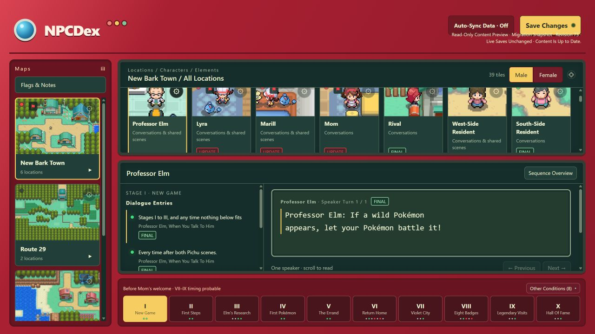

# U20E — NPCDex Migration Preview

**Status:** preparation verified; awaiting the required migration acceptance. U20E is not complete. **Model:** Sol / High. Installed ROMDex **0.5.7** and the GitHub-backed NPCDex remain authoritative. No real NPCD content has been uploaded or activated.

## Proposed Result

Store permanent, structured content in the private **NPCDex Content (NPCD)** project on `thegobindsingh.youtrack.cloud`. PMON development tasks remain separate. Preserve NPCDex's familiar view and append proposed changes to current content. This import neither creates actionable PMON work nor hands anything to an agent.

The confirmed hierarchy places **New Bark Town, Route 29 and Cherrygrove City under Johto**. Global Dialogue remains shared, outside either region. Existing location aliases remain aliases; an alias does not create a duplicate physical area. Shared character profiles retain distinct local appearances and player-gender alternatives. Additional region organization can be added when it has content.

| Existing Data | Proposed Preservation |
| --- | --- |
| Revision 73; 4 visible collections | Same 4 collections, including Global Dialogue |
| 20 location entries; 23 source areas | Original visible entries/aliases preserved; 15 logical physical sub-zones |
| 54 character rows | Same visible rows; 50 shared profiles and 68 local/scene-participant appearances |
| 128 content elements | All retained; scenes and interactive objects remain distinct |
| 193 points; 448 blocks | All text, IDs, order, gender variants and source/control metadata retained |
| 870 scoped content identities | All mapped explicitly; none unresolved |
| 44 plans; 85 annotations | All mapped; exact original instructions, notes and proposed dialogue preserved |
| 145 history entries; 6 exported request records | Exact originals retained, including their old hash/pointer context |
| 159 embedded image occurrences | All retained; 39 distinct image objects plus the original export object |

The proposed backend contains **211 permanent records plus one registry issue**, not 870 development tickets. Its records comprise 1 region, 3 maps, 15 sub-zones, 50 profiles, 68 appearances, 10 scenes, 57 interactive objects and 7 shared/compatibility records. Scene-participant appearances reference existing documented characters/scenes; they do not invent ROM events. No Kanto map is present in the current save.

The import includes the **complete original 9,915,298-byte export and history as a recovery object in NPCD**, along with structured records and deduplicated images. Originals also remain protected locally and in private GitHub storage. NPCD access remains restricted to the approved owner/trusted instance administrators; agent grants are a later U23 decision. Required agent-facing data will be included in explicitly staged task packages later, rather than granting access to every save/archive.

## Evidence

Read-only Windows checks unlocked the existing protected credential, inspected the latest private GitHub save and reconstructed it in an isolated journal copy. The local mirror and cloud head matched, with **zero queued uploads and no unresolved conflict**. A second fresh check confirmed the same source. All three credential files remained byte-unchanged. No token was requested, logged or committed.

Source fingerprint: `2c50ee40f590eb1505a99922efa948db282fe46425bf640b5a0f69fc780c630c`.

Cloud content head: `90af156ca7819445a31dcdd394682722458281d5283e0b3cf0da3263d70f80d0`.

All original export bytes can be recovered exactly. The complete dynamically reconstructed frontend document matches the original values, including unknown fields, aliases, image mappings, source baselines, testing/decision state and history. An isolated correction to a shared routine changed its displayed current dialogue while preserving the old export, plans and history. Added/archived Planned Additions and later versions of imported drafts also passed checks.

**517 regression tests passed**, including 16 new migration/scale checks. Full-data reconstruction takes seconds locally and the initial verified cache payload is about **32 MiB** under its 256 MiB bound. These are Windows/Node measurements with an in-memory transport; **they are not full-size YouTrack WAN latency measurements**. Actual full-size upload/download verification must pass before authority activation. A small real GitHub source check used 9 read-only requests; it does not establish YouTrack throughput.

The initial carrier is approximately **266 KiB**, so its bound was raised from 256 KiB to the **already demonstrated 512 KiB attachment size**. Larger objects remain hash-verified chunks; there is no arbitrary upload-size increase. The accepted U20A contract schema is unchanged.

## Retention and Routine Sync

- Domain snapshots and upload-intent previews reference shared, verified immutable objects. Repeated snapshots do not duplicate the complete history. Unchanged state does not rewrite the SQLite payload.
- Keep up to 200 pending operations and 32 recent terminal operations in the active journal. Older committed/cancelled operations are archived locally with their original previews and delivery evidence; uncertain work is never archived away as completed.
- Routine polls inspect current issue/comment metadata and complete attachment inventories. Previously verified bytes may be reused only when the fresh attachment identity, author, size and update marker match. Registry manifests are always reread. A fresh client, manual Save and periodic full audits reread file bytes; audits run at least every 15 minutes while automatic sync is running. Auto-Sync Off performs no automatic remote reads or writes.
- No remote history is automatically deleted. Existing object, collection, cache and publication bounds remain explicit. Reaching a bound retains the last accepted view and requires review; it is not permission to prune original histories. A larger validated checkpoint/retention strategy is required before exceeding the current 1,000-publication or storage bounds.

## One Authority and GitHub Backup Policy

After a verified handoff, **NPCD is the only editable NPCDex content authority**. GitHub's old NPCDex journal becomes retained recovery history, not a second master. Future GitHub recovery exports must identify their source NPCD publication and are restored first into an isolated workspace for comparison/review. No bidirectional merge between two independent editable NPCDex providers is enabled.

ROMDex metadata still using GitHub remains in its separate namespace. Existing cloud, YouTrack and updater tokens stay preserved; their scopes are not changed by this preview.

## Acceptance and Handoff Procedure

1. Accept this source/identity/storage preview. If the source changed, regenerate and review the difference; this acceptance cannot overwrite newer work.
2. Prepare the handoff-capable candidate and resumable publication journal. Recheck NPCD identity/access, existing records and source fingerprints. A helper may stage only the accepted record set; no PMON or agent write route is included.
3. At the handoff, finish/cancel open edits, save and quit the old app. Preserve a complete protected Data backup and consistent journal snapshot, all unresolved branches/drafts and all remembered credentials. Any pending/conflicted source work holds the switch for review.
4. Publish dependencies and native relationships using recorded operation IDs; recover uncertain responses before retrying. Append the complete registry manifest last. Download and reconstruct the real published dataset, checking original bytes, assets, memberships, compatibility and all displayed data. Measure actual YouTrack latency before switching.
5. Activate one provider only through a verified application handoff. The existing 0.5.7 app is not switched merely by placing new files in its Data folder. If upload, readback, performance or handoff checks fail, retain the current GitHub-backed application as authority and keep staged records for recovery/review.
6. Complete U20E's report/checklist and stop. **U20F installed-app acceptance and private release require their own PASSKEY.**

Before the switch, rollback means continuing the untouched current application/GitHub save. After any new content edits exist, rollback first preserves both NPCD and local pending work and compares them to the backup; restoring an old snapshot over newer edits is never automatic.

## Remaining Boundaries

Actual ROM/source files were not supplied. Mappings honestly say **Unresolved** for ROM targeting and preserve saved documentation evidence; nothing is promoted to ROM-verified or tested merely by migration. Native prose/title/comment discrepancies remain review conditions; complete installed native-edit adoption belongs to U20F. Task packaging, agent access and implementation-result authorization remain U21–U25. YouTrack's configured upload ceiling and remaining storage quota are still unavailable to this account; safe transfer failure cannot trigger a provider switch.

